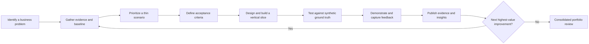

  <a href="README.md">← Case Study Introduction</a> ·
  <a href="01-enterprise-profile/README.md">Enterprise Profile</a> ·
  <a href="02-business-discovery/README.md">Discovery</a>

**Company - NorMack Shipping LLC:** Iterative Enterprise Transformation Roadmap  
**Portfolio Case Study:** Fictional organization and synthetic data  
**Status:** Planning  
**Repository:** Portfolio_DC/case-studies/Normack-shipping/  
**GitHub Project:** Portfolio_DC (Project #17)

# 1. Purpose and Operating Approach
NorMack Shipping LLC is a fictional 15-person company whose primary business is contracted air and ground cargo pickup and delivery, including LTL and freight services. Complementary operations include temporary in-transit cargo storage, custom hybrid/corrugated crating (triple-wall corrugated board, wood framing, protective systems), and interlocking/specialty pallet assembly.

The portfolio demonstrates an iterative, evidence-led transformation: investigate reported problems, make business hypotheses explicit, develop requirements, test thin end-to-end solutions, collect feedback, and improve them. Phases are navigation and competency areas—not sequential approval barriers. Discovery, requirements, design, data engineering, application development, validation, BI, and storytelling recur during every iteration.

All entities, records, incidents, results, customer relationships, and KPIs are simulated. References to recognizable carriers (such as DHL) describe an industry context, not actual contracts or endorsements.  
## Objectives
1. Examine how dispatch, storage, crating, pallet assembly, purchasing, staffing, finance, and reporting influence each other.
2. Show traceability from symptom and evidence to requirements, decisions, implementation, tests, and business recommendations.
3. Build consistent, reproducible synthetic datasets supporting all portfolio artifacts.
4. Create browser-accessible demonstrations where possible, clearly distinguishing simulations from native Power Apps, Power BI, or Business Central implementations.
5. Publish only validated deliverables and label forecast or scenario results appropriately.

### 9. Preliminary Operational Assessment — Day-in-the-Life & Discovery Plan: Enterprise Foundation D00 — Executive Decision Support D07
Outcome: A coherent, believable small-business operating model and enough synthetic-data specification to investigate the first cross-functional issue.
- [ ] Confirm service catalog: ground and air cargo pickup/delivery, LTL, temporary transit storage, hybrid crating, specialty pallets.
- [ ] Draft 15-position organization and RACI with realistic combined duties.
- [ ] Define physical assets: facilities, vehicle types, equipment and storage zones (assumptions explicitly marked).
- [ ] Define core order-to-delivery workflow and storage handoff points.
- [ ] Write 3–5 executive-reported symptoms without presupposing causes.
- [ ] Draft stakeholder interview guide and first evidence-request list.
- [ ] Define synthetic data dictionary v0.1 and stable master IDs.
- [ ] Choose a first vertical slice (PRB-001: late or disputed shipment handoff).
- [ ] Review scope, set initial acceptance criteria and record open decisions.
   
# 2. Iterative Delivery Model  

### Iteration Cadence
Use timeboxed 1–2 week iterations as a planning target, not a fixed commitment. Each iteration ends with a reviewable artifact, verification evidence, an updated risk/decision log, and a revised backlog. A brief discovery spike can precede a build slice when data or requirements are uncertain.

### Definition of Ready
- Business question, stakeholder perspective, and affected services identified.
- At least one hypothesis and the evidence needed to test it recorded.
- Synthetic data requirements and privacy-safe assumptions documented.
- Acceptance criteria stated in testable terms; key dependencies known.  
### Definition of Done / Showcase Ready
- Work item has a clear business problem, scope, and traceable requirements.
- Source, sample data, generation method, and run instructions are reproducible where applicable.
- Evidence of testing/validation and limitations is provided.
- Narrative distinguishes observed synthetic results, modeled scenarios, and unimplemented recommendations.
- README includes links to relevant documents, code, and a demonstration (or screenshots/video when interactive hosting is infeasible).
- No live credentials, private operational data, or paid-service access required of viewers.  

## 3. Outcome-Driven Iterations

The following are candidate iterations, not a waterfall critical path. Priorities will be reviewed and adjusted after each iteration based on evidence, business value, technical dependencies, and feedback.

### Iteration D00 — Enterprise Foundation

**Business Question:** What services, roles, transactions, and constraints define NorMack?

**Evidence & Deliverables**
- P01 Enterprise profile and Operating Model
- P02 Organizational Structure and Responsibility Matrix
- P03 Service Catalog For Logistics, Storage, Crating, and Specialty Pallets
- P04 Business Scenario Charter and Operating Assumptions
- P05 Source-of-Truth and Data Governance Rules
- P06 Synthetic Data Generator Specification

**GitHub Issues:** BA-09, BA-07, BA-01, BA-10

---

### Iteration D01 — Order-to-Delivery

**Business Question:** Why are pickups and deliveries late, and which operational handoffs contribute?

**Evidence & Deliverables**
- P07 Shipment Lifecycle and Event Datasets
- P08 AS-IS Pickup-to-Selivery Process Map
- P09 Simulated Stakeholder Interviews
- P10 Operational KPI Baseline
- P11 Root-Cause Hypotheses and Supporting Evidence
- P12 Initial Dispatch Performance Dashboard

**GitHub Issues:** BA-07, BA-01, BA-06, DE-03, BI-01, ST-01

---

### Iteration D02 — In-Transit Storage

**Business Question:** Why is cargo difficult to locate, release, or reconcile?

**Evidence & Deliverables**
- P13 Chain-of-custody and location datasets
- P14 Receiving, storage, and release workflows
- P15 Entity Relationship Diagram (ERD)
- P16 User stories and acceptance criteria
- P17 Functional design for cargo tracking
- P18 Browser-based storage tracking proof of concept

**GitHub Issues:** APP-01, BA-04, BA-05, BA-02, DE-02, BA-08

---

### Iteration D03 — Crating & Specialty Pallets

**Business Question:** How do quoting, material shortages, assembly, and scheduling affect shipment readiness and profitability?

**Evidence & Deliverables**
- P19 Custom crate and specialty pallet specifications
- P20 Bill of Materials (BOM) and material inventory datasets
- P21 Procurement-to-assembly process maps
- P22 Product costing and margin models
- P23 Functional and technical designs
- P24 Supply chain and assembly management prototype

**GitHub Issues:** APP-02, APP-03, BA-02, BA-03, DE-05, BI-02

---

### Iteration D04 — Trusted Enterprise Data

**Business Question:** Can operations and finance agree on consistent transactions, measures, and reporting outcomes?

**Evidence & Deliverables**
- P25 Enterprise data dictionary
- P26 Raw and curated synthetic datasets
- P27 SQL database implementation
- P28 Optional Microsoft Fabric data pipelines
- P29 Data quality and reconciliation rules
- P30 Dimensional models and semantic layer
- P31 Data lineage documentation

**GitHub Issues:** DE-01, DE-02, DE-03, DE-04, DE-05, BI-06, BI-08

---

### Iteration D05 — Analytics & Forecasting

**Business Question:** What drives service performance, costs, operational capacity, and customer demand?

**Evidence & Deliverables**
- Interactive operational KPI dashboards
- Financial performance and profitability reports
- Advanced DAX measures
- Power Query M transformations
- Statistical analysis using R
- Predictive forecasting models
- Scenario analysis and sensitivity testing
- Validation of analytical results

**GitHub Issues:** BI-01 through BI-08, ST-02, ST-03

---

### Iteration D06 — Applications & User Experience

**Business Question:** Which targeted technology solutions can reduce manual work, improve accountability, and strengthen operational control?

**Evidence & Deliverables**
- P32 Power Platform application designs
- P33 Browser-accessible application simulations
- P34 MERN full-stack application
- P35 REST API and integration specifications
- P36 User interface and usability demonstrations
- P37 Role-based access and permissions testing
- P38 Functional and technical validation

**GitHub Issues:** APP-01 through APP-06, BA-03, BA-10, BA-08

---

### Iteration D07 — Executive Decision Support

**Business Question:** Which recommendations offer the greatest expected operational and financial value?

**Evidence & Deliverables**
- P39 Evaluation of alternative solutions
- P40 Cost-benefit analysis and ROI assumptions
- P41 Executive KPI scorecard
- P42 Scenario comparison and business recommendations
- P43 Interactive PowerPoint presentation
- P44 Portfolio demonstration walkthrough
- P45 Final assessment of simulated business outcomes

**GitHub Issues:** ST-01 through ST-05, BA-09, BA-08

---

### Continuous Feedback & Improvement

Every iteration includes opportunities to revisit and improve previous work.

New findings may require revisions to:

- Business Requirements Documents (BRD)
- Functional Design Documents (FDD)
- Technical Design Documents (TDD)
- Business process maps
- UML and ERD models
- Synthetic data structures
- Application designs
- Test cases and acceptance criteria
- Priorities and backlog items

Changes will be documented through decision logs, version control, and requirements traceability.

---

## 4. GitHub Issue & Phase Map

The portfolio contains 34 showcase issues organized into five professional competencies.

Issue identifiers provide traceability across iterations, deliverables, and case-study phases. An issue may contribute to multiple iterations.

### Business Analysis & Solution Documentation

**Issues:** BA-01 through BA-10

**Primary Phases**
- [01 — Enterprise Profile](01-enterprise-profile/README.md)
- [02 — Business Discovery](02-business-discovery/README.md)
- [03 — Requirements & Business Case](03-requirements-and-business-case/README.md)
- [04 — Solution Design](04-solution-design/README.md)
- [07 — Testing & Validation](07-testing/README.md)

### Data Storytelling & Executive Communication

**Issues:** ST-01 through ST-05

**Primary Phases**
- [03 — Requirements & Business Case](03-requirements-and-business-case/README.md)
- [09 — Executive Storytelling](09-executive-storytelling/README.md)

### Business Intelligence & Data Analytics

**Issues:** BI-01 through BI-08

**Primary Phases**
- [08 — Business Intelligence](08-business-intelligence/README.md)
- [09 — Executive Storytelling](09-executive-storytelling/README.md)

### Enterprise Applications & Full-Stack Development

**Issues:** APP-01 through APP-06

**Primary Phases**
- [04 — Solution Design](04-solution-design/README.md)
- [06 — Applications](06-applications/README.md)

### Data Engineering & Database Architecture

**Issues:** DE-01 through DE-05

**Primary Phases**
- [05 — Data Engineering](05-data-engineering/README.md)
- [07 — Testing & Validation](07-testing/README.md)

### Prioritization Framework

Each candidate work item will be scored from 1 to 5 against the following criteria:

| Criterion | Weight | Evaluation |
|:---|:---:|:---|
| Business Impact | 2 | Expected operational or financial value |
| Evidence Readiness | 1 | Availability of supporting data and requirements |
| Reusability | 1 | Value to other portfolio deliverables |
| Demonstration Value | 1 | Ability to showcase relevant professional skills |
| Effort & Risk | -1 | Complexity, resource requirements, and uncertainty |

**Priority Score**

Priority = (2 × Business Impact) + Evidence Readiness + Reusability + Demonstration Value − Effort & Risk

The scoring model supports prioritization but does not replace professional judgment. Safety, confidentiality, compliance, and critical dependencies take precedence.

---

## 5. Cross-Functional Data Backbone

NorMack will use a consistent, interconnected synthetic data architecture supporting all operational divisions.

Datasets will be generated incrementally rather than attempting to build the entire enterprise data model in advance.

### Data Generation Principles

- Use deterministic synthetic data generation with documented random seeds.
- Maintain consistent primary and foreign keys.
- Preserve referential integrity across business domains.
- Maintain schema and generator version history.
- Introduce controlled defects for data quality investigations.
- Maintain separate ground-truth datasets and defect manifests.
- Ensure operational events can be traced across business functions.

### 5.1 Customers & Contracts

**Core Data:** CustomerID, ContractID, ServiceLevel, RateCardID

**Business Purpose:** Manage contracted customers, agreed service levels, pricing, and commercial relationships.

**Cross-Functional Dependencies:** Shipment orders, invoicing, customer profitability, and contract performance.

### 5.2 Shipments & Events

**Core Data:** ShipmentID, StopID, PickupWindow, DeliveryWindow, ScanEventID

**Business Purpose:** Track cargo from pickup through temporary storage, transfer, and final delivery.

**Cross-Functional Dependencies:** Dispatch, vehicle assignment, storage, proof of delivery, customer billing, and performance reporting.

### 5.3 Capacity & Personnel

**Core Data:** EmployeeID, RoleID, VehicleID, ShiftID

**Business Purpose:** Track staffing, assignments, operational capacity, and labor availability.

**Cross-Functional Dependencies:** Dispatch scheduling, vehicle utilization, workforce productivity, and labor costs.

### 5.4 Temporary Storage

**Core Data:** StorageLotID, LocationID, CustodyEventID, ReleaseAuthorizationID

**Business Purpose:** Support cargo receiving, location tracking, custody accountability, and release controls.

**Cross-Functional Dependencies:** Shipment visibility, storage charges, warehouse capacity, and customer service.

### 5.5 Crating & Specialty Pallets

**Core Data:** ProductID, DesignID, BOMID, WorkOrderID

**Business Purpose:** Manage custom product specifications, materials, fabrication, and assembly.

**Cross-Functional Dependencies:** Inventory, procurement, production scheduling, costing, and shipment readiness.

### 5.6 Purchasing & Inventory

**Core Data:** VendorID, PurchaseOrderID, ItemID, InventoryTxnID

**Business Purpose:** Manage supplier purchases, receiving, inventory movements, and material availability.

**Cross-Functional Dependencies:** Assembly, warehouse operations, stock reconciliation, and financial reporting.

### 5.7 Finance & Accounting

**Core Data:** InvoiceID, CostEntryID, GLAccountID, BudgetScenarioID

**Business Purpose:** Track revenue, expenses, operating costs, profitability, budgets, and forecasts.

**Cross-Functional Dependencies:** Service pricing, shipment costs, labor, materials, and executive reporting.

### 5.8 Quality & Exceptions

**Core Data:** ExceptionID, DamageClaimID, ValidationRuleID

**Business Purpose:** Investigate operational incidents, shipment exceptions, damage claims, and data quality problems.

**Cross-Functional Dependencies:** Root-cause analysis, quality management, claims processing, and testing.

### Enterprise Data Rule

Operational events will have unique, immutable identifiers and recorded event timestamps.

Calculated statuses and KPIs will derive from documented business rules.

Raw source events will remain separate from curated reporting tables and snapshots, allowing realistic reconciliation and data quality exercises without compromising the underlying ground truth.

---

## 6. Requirements & Deliverable Traceability

Every significant business problem, requirement, design decision, implementation, and test should be traceable.

| Artifact | Identifier Example | Purpose |
|:---|:---|:---|
| Business Problem | PRB-001 | Identify operational symptoms and business impact |
| Business Requirement | REQ-001 | Define required business capabilities |
| User Story | US-001 | Describe user needs and expected behavior |
| Business Process | PROC-001 | Document current and future workflows |
| Data Quality Rule | DQ-001 | Define data validation and integrity requirements |
| Architecture Decision | ADR-001 | Record technical choices and alternatives |
| Test Case | TC-001 | Validate functionality and requirements |
| Key Performance Indicator | KPI-001 | Define measurable business performance |

### Example Traceability Chain

Business Problem → Evidence → Requirement → User Story → Design → Implementation → Test → KPI → Executive Recommendation

This convention allows portfolio reviewers to follow how a reported issue becomes a validated technical deliverable.

Relative links will connect documentation stored in the phase folders. Corresponding GitHub Issues will be linked as work items are completed.

---

## 7. Risks, Controls & Assumptions

### 7.1 Synthetic Data Misrepresented as Actual Results

**Risk:** Simulated business outcomes could be mistaken for results achieved by an actual customer.

**Control:** Clearly label synthetic datasets, fictional scenarios, modeled outcomes, and simulated improvements.

### 7.2 Third-Party Brand Associations

**Risk:** References to known freight carriers could imply actual contracts, affiliations, or endorsements.

**Control:** Use recognizable company names only for industry context. Do not claim actual customer relationships or endorsements.

### 7.3 Inconsistent Business Rules

**Risk:** Different reports or applications may calculate the same operational KPI differently.

**Control:** Maintain a shared data dictionary, standardized business rules, version-controlled metrics, and consistent synthetic records.

### 7.4 Microsoft Platform Licensing Constraints

**Risk:** Some Microsoft applications may require subscriptions or authenticated environments that public portfolio visitors cannot access.

**Control:** Provide source code, technical documentation, architecture diagrams, recorded demonstrations, and browser-based simulations where practical.

### 7.5 Security & Confidentiality

**Risk:** Credentials, private configuration files, or confidential information could be unintentionally committed to GitHub.

**Control:** Use synthetic data, environment-variable templates, appropriate .gitignore rules, and secret scanning before publication.

### 7.6 Uncontrolled Scope Expansion

**Risk:** Additional features and requirements may significantly increase development effort.

**Control:** Build small vertical slices, maintain work-in-progress limits, evaluate dependencies, and reprioritize after each iteration.

### 7.7 Broken Navigation & Missing Deliverables

**Risk:** Portfolio navigation links may reference incomplete or missing files.

**Control:** Maintain README files in each phase directory, use relative links, and verify navigation before publication.

---

**Project Governance Principle:** NorMack's roadmap is a living document. New evidence, testing results, and stakeholder feedback may change priorities, requirements, designs, and delivery sequences.

The objective is not to follow a fixed plan regardless of findings, but to demonstrate disciplined, evidence-based continuous improvement.

# 8. Portfolio Publication Plan
- Start page: [NorMack Scenario Introduction](README.md) explains the fictional company, problem and the route through the case study.
- Roadmap: This file shows planned increments, quality gates, and decisions.
- Nine phase landing pages: Navigate by lifecycle and competency; link to actual outputs only as those outputs exist.
- Competency entry points: Business Intelligence, Data Engineering, Enterprise Applications, Solution Documentation, and Executive Storytelling.
- Project tracking: GitHub Project #17 holds issue status, priority, competency, technology and dependencies. Keep planning tasks distinct from completed showcase evidence.  

Portfolio disclaimer: This is a simulated enterprise transformation developed for professional demonstration. No client data or real operational outcomes are claimed.
