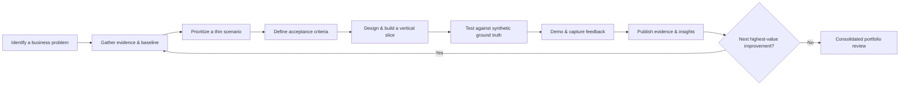

  <a href="README.md">← Case Study Introduction</a> ·
  <a href="01-enterprise-profile/README.md">Enterprise Profile</a> ·
  <a href="02-business-discovery/README.md">Discovery</a>

**Company - NorMack Shipping LLC:** Iterative Enterprise Transformation Roadmap  
**Portfolio Case Study:** Fictional organization and synthetic data  
**Status:** Planning  
**Repository:** Portfolio_DC/case-studies/Normack-shipping/  
**GitHub Project:** Portfolio_DC (Project #17)  

1. Purpose and operating approach
NorMack Shipping LLC is a fictional 15-person company whose primary business is contracted air and ground cargo pickup and delivery, including LTL and freight services. Complementary operations include temporary in-transit cargo storage, custom hybrid/corrugated crating (triple-wall corrugated board, wood framing, protective systems), and interlocking/specialty pallet assembly.

The portfolio demonstrates an iterative, evidence-led transformation: investigate reported problems, make business hypotheses explicit, develop requirements, test thin end-to-end solutions, collect feedback, and improve them. Phases are navigation and competency areas—not sequential approval barriers. Discovery, requirements, design, data engineering, application development, validation, BI, and storytelling recur during every iteration.

All entities, records, incidents, results, customer relationships, and KPIs are simulated. References to recognizable carriers (such as DHL) describe an industry context, not actual contracts or endorsements.
Objectives
1. Examine how dispatch, storage, crating, pallet assembly, purchasing, staffing, finance, and reporting influence each other.
2. Show traceability from symptom and evidence to requirements, decisions, implementation, tests, and business recommendations.
3. Build consistent, reproducible synthetic datasets supporting all portfolio artifacts.
4. Create browser-accessible demonstrations where possible, clearly distinguishing simulations from native Power Apps, Power BI, or Business Central implementations.
5. Publish only validated deliverables and label forecast or scenario results appropriately.
2. Iterative delivery model

Iteration cadence
Use timeboxed 1–2 week iterations as a planning target, not a fixed commitment. Each iteration ends with a reviewable artifact, verification evidence, an updated risk/decision log, and a revised backlog. A brief discovery spike can precede a build slice when data or requirements are uncertain.
Definition of Ready
- Business question, stakeholder perspective, and affected services identified.
- At least one hypothesis and the evidence needed to test it recorded.
- Synthetic data requirements and privacy-safe assumptions documented.
- Acceptance criteria stated in testable terms; key dependencies known.
Definition of Done / Showcase Ready
- Work item has a clear business problem, scope, and traceable requirements.
- Source, sample data, generation method, and run instructions are reproducible where applicable.
- Evidence of testing/validation and limitations is provided.
- Narrative distinguishes observed synthetic results, modeled scenarios, and unimplemented recommendations.
- README includes links to relevant documents, code, and a demonstration (or screenshots/video when interactive hosting is infeasible).
- No live credentials, private operational data, or paid-service access required of viewers.
3. Outcome-driven iterations
The following are candidate iterations, not a waterfall critical path. Reprioritize after each review.
Iteration	Business question and vertical slice	Core evidence & deliverables	GitHub issues emphasized
0 — Foundation	What services, roles, transactions and constraints define NorMack?	Enterprise profile, 15-person role matrix, service catalog, scenario charter, source-of-truth rules, seeded data generator specification	BA-09, BA-07, BA-01, BA-10
1 — Order-to-Delivery	Why are pickups/deliveries late and which handoffs contribute?	Shipment lifecycle events; AS-IS map; interview simulation; KPI baseline; root-cause hypotheses; early dispatch dashboard	BA-07, BA-01, BA-06, DE-03, BI-01, ST-01
2 — In-Transit Storage	Why is cargo difficult to locate, release, or reconcile?	Chain-of-custody and location datasets, storage workflow, ERD, traceable user stories, browser-based cargo tracking proof of concept	APP-01, BA-04, BA-05, BA-02, DE-02, BA-08
3 — Crating & Specialty Pallets	How do quotes, material shortages, assembly and scheduling affect shipment readiness and margin?	Crate/BOM and pallet specifications, procurement-to-assembly map, costing model, functional design, supply-chain prototype	APP-02, APP-03, BA-02, BA-03, DE-05, BI-02
4 — Trusted Enterprise Data	Can operations and finance agree on the same events and measures?	Data dictionary, raw/curated datasets, SQL + optional Fabric pipeline, validation rules, dimensional model, lineage	DE-01, DE-02, DE-03, DE-04, DE-05, BI-06, BI-08
5 — Analytics & Forecasts	What drives service, cost, capacity and demand outcomes?	Interactive KPI and finance reports; DAX, M and R exemplars; forecasting and scenario sensitivity; validation	BI-01–BI-08, ST-02, ST-03
6 — Applications & Experience	Which small solutions reduce manual work and improve accountability?	Power Platform design and evidence, browser simulations, MERN application, APIs, usability and permissions tests	APP-01–APP-06, BA-03, BA-10, BA-08
7 — Executive Decisions	Which recommendations provide the best expected value and what is the evidence?	Alternatives, cost-benefit/ROI assumptions, PowerPoint narrative, executive scorecard, demonstration walkthrough	ST-01–ST-05, BA-09, BA-08

Feedback loops: Any iteration may reopen earlier BRD, FDD, TDD, process map, data model or backlog item. Document changes in the decision log and maintain traceability rather than assuming the first design is final.
4. GitHub issue and phase map (34 showcase issues)
The issue ID prefixes match the proposed portfolio issue titles. Once issue numbers are known, replace text labels with direct links. An item can contribute to several iterations and phases.
Competency	Issue IDs	Primary phase(s)
Business Intelligence & Data Analytics	BI-01, BI-02, BI-03, BI-04, BI-05, BI-06, BI-07, BI-08	[08 — Business Intelligence](08-business-intelligence/README.md), [09 — Storytelling](09-executive-storytelling/README.md)
Enterprise Applications & Full-Stack Development	APP-01, APP-02, APP-03, APP-04, APP-05, APP-06	[06 — Applications](06-applications/README.md), [04 — Design](04-solution-design/README.md)
Data Engineering & Database Architecture	DE-01, DE-02, DE-03, DE-04, DE-05	[05 — Data Engineering](05-data-engineering/README.md), [07 — Testing](07-testing/README.md)
Business Analysis & Solution Documentation	BA-01, BA-02, BA-03, BA-04, BA-05, BA-06, BA-07, BA-08, BA-09, BA-10	[01 — Profile](01-enterprise-profile/README.md), [02 — Discovery](02-business-discovery/README.md), [03 — Requirements](03-requirements-and-business-case/README.md), [04 — Design](04-solution-design/README.md), [07 — Testing](07-testing/README.md)
Data Storytelling & Executive Communication	ST-01, ST-02, ST-03, ST-04, ST-05	[03 — Business Case](03-requirements-and-business-case/README.md), [09 — Storytelling](09-executive-storytelling/README.md)

Prioritization rubric
Score each candidate 1–5 on business impact, evidence readiness, reusability, and employer demonstration value; score effort/risk 1–5 (5 is hardest). Suggested relative priority score: 2 × impact + evidence + reusability + demo value − effort/risk. Use scoring to support—not replace—judgment. Treat regulatory, safety, confidentiality and key data-dependency constraints as overriding gates.
5. Cross-functional data backbone
Build datasets incrementally, not all at once. Maintain a single deterministic synthetic-data generator with seed, schema version, referential-integrity rules, controlled defects, and a separate ground truth / defect manifest.
Domain	Core records and keys	Cross-functional connection
Clients & contracts	CustomerID, ContractID, service level, rate card	Orders, billing and margin
Shipments & events	ShipmentID, StopID, pickup/delivery windows, ScanEventID	Dispatch, storage, proof of delivery
Capacity & personnel	EmployeeID, RoleID, VehicleID, ShiftID	Driver assignment, scheduling, labor cost
Temporary storage	StorageLotID, LocationID, CustodyEventID, release authorization	Shipment visibility and storage billing
Crating & pallets	ProductID, DesignID, BOMID, WorkOrderID	Material inventory, build scheduling, shipment readiness
Purchasing & inventory	VendorID, PurchaseOrderID, ItemID, InventoryTxnID	Procurement, assembly and stock accuracy
Finance	InvoiceID, CostEntryID, GLAccountID, BudgetScenarioID	Revenue, expense, profitability, forecasting
Quality & exceptions	ExceptionID, DamageClaimID, ValidationRuleID	Root cause, incident management and tests

Data rule: Operational events have immutable IDs and event times; derived status and KPIs are calculated from documented business rules. Separate raw events from reporting snapshots to permit discrepancies and reconciliation exercises without contradictory ground truth.
6. Traceability convention
Use consistent cross-document identifiers:
Record	Example	Links to
Business problem	PRB-001 Late deliveries	Evidence, impact, hypothesis
Requirement	REQ-001 Track custody transfers	Business objective, stakeholder
User story	US-001 Warehouse receiver	Requirement, acceptance tests
Process	PROC-001 Receive cargo	AS-IS and TO-BE diagrams
Data rule	DQ-001 Unique ShipmentID	Schema, validation test
Design decision	ADR-001 Event-based tracking	Alternatives, architecture
Test	TC-001 Duplicate scans	Story, expected result
KPI	KPI-001 On-time delivery	Formula, source events, owner

Prefer relative links to artifacts stored in phase folders. Add GitHub Issue links as individual work items are completed.
7. Risks, controls, and assumptions
Risk / concern	Control
Synthetic results mistaken for actual customer results	Visible fictional-data label on each artifact; clear modeled vs measured results
Vendor/service name implies endorsement	Do not claim real contracts or affiliations
Business rules conflict across reports	Shared data dictionary, seeded generator, versioned metric definitions
Paid Microsoft products unavailable for public viewers	Publish code, docs and browser-based simulations; label native product evidence honestly
Public secrets or private information	No real credentials; use .env.example; secret checks before push
Project scope grows beyond capacity	Small vertical slices, WIP limits, review and reprioritization
Phase navigation links break	Automated link check and a README in each phase folder

8. Portfolio publication plan
- Start page: [NorMack Scenario Introduction](README.md) explains the fictional company, problem and the route through the case study.
- Roadmap: This file shows planned increments, quality gates, and decisions.
- Nine phase landing pages: Navigate by lifecycle and competency; link to actual outputs only as those outputs exist.
- Competency entry points: Business Intelligence, Data Engineering, Enterprise Applications, Solution Documentation, and Executive Storytelling.
- Project tracking: GitHub Project #17 holds issue status, priority, competency, technology and dependencies. Keep planning tasks distinct from completed showcase evidence.
9. First iteration: Foundation 0 — actionable plan
Outcome: A coherent, believable small-business operating model and enough synthetic-data specification to investigate the first cross-functional issue.
- [ ] Confirm service catalog: ground and air cargo pickup/delivery, LTL, temporary transit storage, hybrid crating, specialty pallets.
- [ ] Draft 15-position organization and RACI with realistic combined duties.
- [ ] Define physical assets: facilities, vehicle types, equipment and storage zones (assumptions explicitly marked).
- [ ] Define core order-to-delivery workflow and storage handoff points.
- [ ] Write 3–5 executive-reported symptoms without presupposing causes.
- [ ] Draft stakeholder interview guide and first evidence-request list.
- [ ] Define synthetic data dictionary v0.1 and stable master IDs.
- [ ] Choose a first vertical slice (PRB-001: late or disputed shipment handoff).
- [ ] Review scope, set initial acceptance criteria and record open decisions.
Iteration 0 completion criteria: Reviewable enterprise profile, initial service/process context, traceable first business problem, and a documented synthetic-data plan. No requirement to finish all nine phases before beginning the first demonstration.
Portfolio disclaimer: This is a simulated enterprise transformation developed for professional demonstration. No client data or real operational outcomes are claimed.
